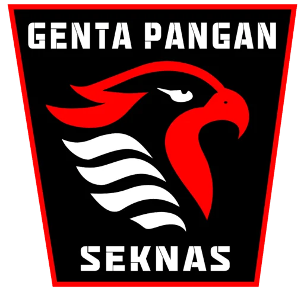

<div align="center">



# GENTA Pangan Banten

**Sistem Pengawasan Dapur MBG (Makan Bergizi Gratis) — Provinsi Banten**

[](https://github.com/Ridho-arachman/sistem-genta/actions/workflows/ci.yml)
[](https://github.com/Ridho-arachman/sistem-genta/actions/workflows/security.yml)

[](https://www.php.net/)
[](https://laravel.com/)
[](https://www.postgresql.org/)
[](https://tailwindcss.com/)
[](https://pestphp.com/)
[](https://github.com/Ridho-arachman/sistem-genta/releases)
[](#lisensi)

</div>

---

## Daftar Isi

- [About](#about)
- [Ringkasan](#ringkasan)
- [Fitur Utama](#fitur-utama)
- [Peran dan Hak Akses](#peran-dan-hak-akses)
- [Arsitektur](#arsitektur)
- [Instalasi](#instalasi)
- [Konfigurasi](#konfigurasi)
- [Akun Awal](#akun-awal)
- [API Mobile](#api-mobile)
- [Build Aplikasi Mobile](#build-aplikasi-mobile)
- [Pengujian dan Kualitas Kode](#pengujian-dan-kualitas-kode)
- [Keamanan](#keamanan)
- [Deployment](#deployment)
- [Release](#release)
- [Dokumentasi](#dokumentasi)
- [Lisensi](#lisensi)

## About

GENTA Pangan Banten adalah sistem pengawasan operasional program Makan Bergizi Gratis (MBG) di Provinsi Banten. Masalah yang dipecahkan: data dapur, kamera CCTV, laporan pengawas, dan surat peringatan (SP) selama ini terpencar dan tidak bisa dipantau dari satu tempat. GENTA menyatukannya dalam satu aplikasi web internal — pendataan dapur dan CCTV, health check kamera otomatis, alur laporan hingga tindak lanjut SP, serta API untuk aplikasi mobile pengawas.

Sistem dipakai empat peran: `admin` (kelola seluruh data), `manajerial` (pemantauan dan ekspor), `pengawas` (laporan lapangan), dan `kepala_dapur` (status dapur sendiri).

Status saat ini: **pengembangan menuju pilot** — belum dipakai penuh di produksi. Urutan rilis dan sisa pekerjaan dilacak di [TASKS.md](TASKS.md) serta [board Kanban](https://github.com/users/Ridho-arachman/projects/17); riwayat perubahan ada di [CHANGELOG.md](CHANGELOG.md).

## Ringkasan

Aplikasi dibangun di atas Laravel 13 dengan empat panel pengguna yang terpisah sesuai peran: administrator, manajerial, pengawas lapangan, dan kepala dapur.

## Fitur Utama

| Modul | Cakupan |
| --- | --- |
| **Autentikasi** | Login, logout, lupa dan reset password, redirect berbasis peran, rate limiting |
| **Dashboard** | Ringkasan statistik dan aktivitas sesuai peran pengguna |
| **Dapur** | CRUD data dapur, status operasional, progres, geofence, data wilayah |
| **CCTV** | Registrasi perangkat, health check otomatis (ffprobe), status, live preview HLS, monitoring terpusat |
| **Anomali CCTV** | Pelaporan, penanganan, dan ekspor data anomali |
| **Laporan** | Penyusunan laporan pengawas dan tindak lanjut |
| **Inspeksi** | Pemantauan laporan inspeksi pengawas dan ekspor (index, create, export) |
| **Surat Peringatan** | Penerbitan SP1–SP3, riwayat, dan ekspor |
| **Manajemen Pengguna** | CRUD pengguna, arsip, pemulihan, hapus permanen, jejak audit |
| **Pengaturan** | Pengaturan aplikasi dan pengelolaan profil, email, serta password |
| **Notifikasi** | Push notification melalui Firebase Cloud Messaging |
| **API Mobile** | Registrasi token FCM, sinkronisasi lokasi, geofence, auto check-in |

## Peran dan Hak Akses

| Modul | `admin` | `manajerial` | `pengawas` | `kepala_dapur` |
| --- | :---: | :---: | :---: | :---: |
| Dashboard | Lihat | Lihat | Lihat | Lihat |
| Dapur | Kelola | Lihat | Detail saja | Lihat |
| CCTV | Kelola | Lihat | — | Lihat |
| Anomali CCTV | Kelola | Lihat + ekspor | — | Lihat |
| Inspeksi | Kelola | Lihat + ekspor | Lihat | — |
| Laporan | Kelola | — | Buat | — |
| Surat Peringatan | Kelola | Lihat | — | — |
| Manajemen Pengguna | Kelola | — | — | — |
| Pengaturan | Kelola | Lihat | Lihat | Lihat |

Otorisasi diterapkan melalui `RoleMiddleware` pada level rute, dan `Policy`/`$this->authorize()` di level model (`CctvAnomalyReportPolicy`, `LaporanPolicy`).

> Peran `pengawas` dibatasi lebih ketat: `RestrictPengawasFromWeb` mem-logout dan melempar ke halaman login bila akun pengawas membuka halaman web dari browser biasa — akses hanya diizinkan dari aplikasi mobile Capacitor (`User-Agent` `GentaCapacitor` atau cookie `capacitor_app=1`). Karena itu modul CCTV dan Anomali CCTV tidak dapat diakses pengawas melalui web.

## Arsitektur

### Teknologi

| Lapisan | Teknologi |
| --- | --- |
| Backend | Laravel 13, PHP 8.5, Laravel Sanctum |
| Frontend | Blade, Tailwind CSS 4, daisyUI 5, Alpine.js 3, Leaflet, Vite 8 |
| Database | PostgreSQL (driver `pgsql`) |
| Queue / cache / session | driver `database` |
| Streaming CCTV | MediaMTX (HLS) + health check ffprobe |
| Mobile | Capacitor (Android) |
| Notifikasi | Firebase Cloud Messaging |
| Pengujian | Pest 5 — suite harus hijau (angka tes mengikuti keluaran `vendor/bin/pest`) |
| Kualitas Kode | Laravel Pint |
| Container | Docker Compose (dev) + Kubernetes/Kustomize (prod): app, queue, scheduler, Postgres, MediaMTX |

### Struktur Direktori

```text
app/
├── Console/                  # Perintah Artisan kustom
├── Exports/                  # Kelas ekspor data
├── Http/
│   ├── Controllers/          # Controller web per modul
│   │   ├── Api/              # MobileController
│   │   └── Auth/             # AuthController
│   ├── Middleware/           # RoleMiddleware, RestrictPengawasFromWeb
│   └── Requests/             # Validasi form request
├── Jobs/                     # Pekerjaan antrean
├── Models/                   # Model Eloquent
├── Policies/                 # Kebijakan otorisasi
├── Services/                 # CsvExport, FcmService, MediaMtxClient, RtspProbe
└── helpers.php

resources/views/
├── admin/                    # Panel administrator
├── manajerial/               # Panel manajerial
├── pengawas/                 # Panel pengawas
├── kepala-dapur/             # Panel kepala dapur
├── auth/                     # Halaman autentikasi
├── components/               # Komponen Blade
└── layouts/                  # Layout utama

routes/web.php                # Rute web dan API mobile
database/migrations/          # Skema database
database/seeders/             # Data demo: user, dapur Banten, CCTV, laporan, settings, SP, anomali
android/                      # Proyek Capacitor (Android)
docker/                       # Dockerfile dan Docker Compose (dev)
k8s/                          # Manifest Kubernetes/Kustomize (prod)
tests/                        # Tes Pest (Feature & Unit)
```

## Instalasi

### Prasyarat

- Docker Desktop (atau Docker Engine + Compose plugin)
- Git

PHP, Composer, Node.js, PostgreSQL, dan MediaMTX sudah berjalan di dalam container — tidak perlu dipasang di host.

### Menjalankan aplikasi

Jalankan semua perintah dari **root repo**. Flag `--env-file .env` wajib supaya interpolasi memakai `.env` root.

```bash
docker compose --env-file .env -f docker/docker-compose.yml up -d --build
docker compose --env-file .env -f docker/docker-compose.yml exec app sh
```

Perintah kedua membuka shell di container `app`. Dari situ jalankan perintah apa pun langsung di lingkungan aplikasi, misalnya:

```bash
php artisan migrate --force
php artisan db:seed
php artisan tinker
php artisan test --compact
```

Ketik `exit` untuk keluar. `db:seed` mengisi data demo dan aman diulang. Setelah seeding, **simpan ulang tiap kamera** (Edit → Save) supaya `stream_key` terdaftar sebagai path MediaMTX — seeder hanya membuat data, bukan path streaming.

Belum ada `.env`? Salin dari `.env.example`, lalu isi `APP_KEY` (`php artisan key:generate` dari shell container), `DB_PASSWORD`, `FCM_SERVER_KEY`, dan `APP_URL` di bawah.

**Konfigurasi IP (wajib kalau diakses dari HP):**

1. **`.env`** → `APP_URL=http://192.168.101.6:8000`
2. **`capacitor.config.json`** → `"url": "http://192.168.101.6:8000"`

`vite.config.js` membaca host dari `APP_URL`, jadi `public/hot` (`http://<IP>:5173`) ikut berubah otomatis — tanpa edit file JS. Kalau CSS/JS gagal dimuat (`net::ERR_FAILED`) setelah ganti IP, hapus `public/hot` dan `public/fonts-manifest.dev.json`, lalu recreate service Vite:

```bash
docker compose --env-file .env -f docker/docker-compose.yml up -d --force-recreate vite
```

Akses aplikasi:

- **Dari PC (browser):** `http://192.168.101.6:8000`
- **Dari HP (browser / WebView Capacitor):** alamat yang sama — perangkat harus satu Wi-Fi dengan PC.

Satu lagi hanya **saran**: halaman "Alamat server" (`public/index.html`) menyimpan IP di `localStorage` dan bisa menerima IP baru lewat formnya tanpa install ulang APK:

```html
<span class="chip" data-url="http://192.168.101.6:8000">IP default (192.168.101.6)</span>
```

> IP Wi-Fi dari DHCP bisa berubah setiap restart router atau pindah jaringan. Setelah ganti IP, perbarui `.env` dan `capacitor.config.json`, recreate `vite`, lalu jalankan `npx cap copy android` saat membangun ulang APK supaya salinan IP di `android/app/src/main/assets/capacitor.config.json` ikut ter-refresh.

### Tanpa Docker (opsional)

Streaming tidak memutar `rtsp_url` langsung di browser: Laravel mendaftarkan `stream_key` kamera ke MediaMTX lewat Control API, lalu browser memutar **WebRTC/WHEP dulu** (`CCTV_WEBRTC_BASE/{stream_key}/whep`) dan jatuh ke **HLS** (`CCTV_HLS_BASE/{stream_key}/index.m3u8`) bila WHEP tidak tersedia. Pakai **empat terminal terpisah**:

```bash
php artisan serve          # web server
php artisan queue:work     # antrean (health check, notifikasi, ekspor)
php artisan schedule:work  # scheduler — health check tiap menit
.\mediamtx.exe .\docker\mediamtx.yml   # media server (sesuaikan path binary)
```

`.env` untuk jalur ini: `DB_CONNECTION=pgsql`, `CCTV_HLS_BASE=http://127.0.0.1:8888`, `CCTV_MEDIAMTX_API=http://127.0.0.1:9997`. Verifikasi dengan `curl -s http://127.0.0.1:9997/v3/paths/list` dan `curl -s -I http://127.0.0.1:8888/`. Aset produksi sudah ada di `public/build`, jadi `npm run dev` tidak wajib.

Preview ada di halaman **detail CCTV** maupun kartu Monitoring CCTV, dan kartu tetap memutar selama `stream_key` sudah terdaftar walau badge status masih `offline` (status diperbarui tiap menit oleh health check).

> `CCTV_HLS_BASE` wajib `http://127.0.0.1:8888` saat preview dibuka dari browser pada PC yang menjalankan MediaMTX: MediaMTX memasang cookie `Secure` untuk HLS, dan browser hanya menerimanya pada origin yang trusted — `http://127.0.0.1` dan `http://localhost` ya, `http://192.168.x.x` tidak. Kalau preview dibuka dari Android/WebView di Wi-Fi (bukan dari PC MediaMTX), letakkan MediaMTX di belakang HTTPS atau pakai WebRTC (`:8889`) sebagai pengganti HLS; mengganti `CCTV_HLS_BASE` ke IP LAN saja **tidak** cukup.

> Status kamera memakai `CCTV_HLS_BASE` juga: health check meminta `index.m3u8?cookieCheck=1` untuk memastikan stream benar-benar bisa diputar (bukan sekadar path terdaftar di MediaMTX). Karena itu preview yang jalan di browser **pasti** berarti status `online`, dan RTSP yang mati/kedaluwarsa akan turun jadi `offline`. Satu kamera mati butuh waktu tunggu sumber sampai `sourceOnDemandStartTimeout` (default 10 detik) sebelum status berubah.

## Konfigurasi

Konfigurasi utama berada di `.env`. Variabel yang perlu diperhatikan:

| Variabel | Keterangan |
| --- | --- |
| `APP_URL` | URL dasar aplikasi — pakai IP LAN (mis. `http://192.168.101.6:8000`) supaya HP bisa mengakses; dibaca juga oleh `vite.config.js` |
| `DB_CONNECTION`, `DB_HOST` | Docker Compose memaksa `pgsql` dan host `postgres` di dalam container; `.env.example` tetap `sqlite` untuk jalur tanpa Docker |
| `SESSION_DRIVER`, `CACHE_STORE`, `QUEUE_CONNECTION` | Driver session, cache, dan antrean (`database`) |
| `FCM_SERVER_KEY` | Server key Firebase Cloud Messaging untuk push notification (wakili variabel yang dibaca `FcmService`) |
| `CCTV_HLS_BASE` | Base URL HLS media server (kosong = preview kamera tidak tampil) |
| `CCTV_MEDIAMTX_API`, `CCTV_MEDIAMTX_USER`, `CCTV_MEDIAMTX_PASS` | Control API MediaMTX dan kredensialnya (kosong = sinkronisasi path nonaktif); Compose memaksa `http://mediamtx:9997`, jalur tanpa Docker pakai `http://127.0.0.1:9997` |
| `CCTV_MEDIAMTX_RTSP` | Alamat RTSP MediaMTX untuk path turunan (kamera dengan RTSP URL sama) |
| `CCTV_WEBRTC_BASE` | Base URL WebRTC/WHEP media server (kosong = pemutar hanya HLS) |
| `CCTV_PROBE_TIMEOUT` | Batas waktu probe ffprobe per kamera (detik) |
| `CCTV_FFPROBE` | Nama/path binary ffprobe (kosongkan saja bila `ffprobe` sudah ada di PATH) |

Nilai sensitif seperti `.env`, keystore, dan cookie lokal tidak disertakan dalam repositori.

## Akun Awal

Setelah menjalankan `php artisan db:seed` lewat shell container `app` (atau `php artisan migrate --seed` di host), tersedia akun berikut:

| Email | Password | Peran |
| --- | --- | --- |
| `admin@test.com` | `password` | Administrator |
| `manajerial@test.com` | `password` | Manajerial |
| `pengawas@test.com` | `password` | Pengawas |
| `pengawas2@test.com` | `password` | Pengawas |
| `pengawas3@test.com` | `password` | Pengawas |
| `kepaladapur@test.com` | `password` | Kepala Dapur |

> Akun di atas hanya untuk pengembangan. Seluruh kredensial wajib diganti sebelum digunakan di lingkungan produksi.

## API Mobile

Endpoint mobile tersedia pada prefix `api/mobile` dan menggunakan autentikasi token Sanctum.

```http
Authorization: Bearer <token>
```

| Method | Endpoint | Deskripsi |
| --- | --- | --- |
| `POST` | `/api/mobile/fcm-token` | Menyimpan token FCM perangkat |
| `POST` | `/api/mobile/absensi/auto-checkin` | Check-in otomatis berdasarkan lokasi |

## Build Aplikasi Mobile

```bash
npm run build
npx cap sync android
```

Setelah itu bangun APK lewat Android Studio (`Build > Generate Signed App Bundle / APK`) atau `./gradlew assembleRelease` dari direktori `android/`. Skrip build batch/PowerShell yang dulu ada sudah dihapus dari repositori.

APK release ditandatangani menggunakan `gentapangan.keystore` — sesuai `storeFile` di `android/app/build.gradle`, file ini tidak disimpan di repositori (`.gitignore` mem-ignore `*.keystore`), jadi tiap pembuat APK menyediakan sendiri.

## Pengujian dan Kualitas Kode

```bash
php artisan test --compact
```

Cakupan pengujian mencakup autentikasi dan rate limit login, CCTV (health check, sinkronisasi MediaMTX, anomali), dapur, laporan, dan API mobile. Backend memakai SQLite in-memory dan server MediaMTX dipaksa nonaktif agar tes tetap terisolasi dari jaringan nyata.

Menjalankan formatter:

```bash
vendor/bin/pint --dirty
```

CI (GitHub Actions) menjalankan `composer validate`, Pint, Pest, dan build aset (`npm run build`) pada setiap push dan pull request — lihat [`.github/workflows/ci.yml`](.github/workflows/ci.yml).

## Keamanan

- Otorisasi berbasis peran pada rute dan kebijakan pada level model
- Proteksi CSRF, escaping output Blade, dan pencegahan SQL injection melalui Eloquent
- Rate limiting pada rute autentikasi (limiter `auth`: 5/menit IP + 30/menit email), API mobile (limiter `mobile`: 30/menit per user), dan semua rute web terproteksi (limiter `web`: 60/menit per user per rute)
- Hashing password dengan bcrypt
- Token API Sanctum (`expiration` masih `null` di `config/sanctum.php`, atur bila ingin token kedaluwarsa)
- Kolom audit dan soft delete untuk manajemen pengguna

Laporkan potensi kerentanan secara internal kepada tim pengelola sistem, bukan melalui issue publik.

## Deployment

Mode dev memakai Docker Compose (`docker/docker-compose.yml`); mode prod memakai Kubernetes/Kustomize di `k8s/overlays/prod`. Detail di [docker/README.md](docker/README.md) dan [k8s/README.md](k8s/README.md).

### Komponen prod

| Komponen | Docker image | Replika |
|----------|--------------|---------|
| Postgres (DB, session, queue, cache) | `postgres:16-alpine` | 1 |
| Web (nginx + php-fpm) | `genta-app:prod` | 2 |
| Queue (`queue:work`) | `genta-app:prod` | 3 |
| Scheduler (`schedule:work`) | `genta-app:prod` | 1 |
| MediaMTX (streaming CCTV) | `bluenviron/mediamtx:1.21.4` | 1 |

Semua komponen di dalam klaster saling terhubung lewat nama Service K8s (`genta-postgres`, `genta-mediamtx`, dll.), bukan `127.0.0.1` host laptop.

### Prasyarat

- Docker dan `kubectl` yang terhubung ke klaster Kubernetes.
- StorageClass default aktif (digunakan PVC PostgreSQL `genta-postgres-data`).
- Untuk prod: ingress controller (mis. `ingress-nginx`) dan sertifikat TLS.

### Cara menjalankan

Edit `.env` di root repo terlebih dahulu — itu adalah sumber kebenaran satu-satunya (`APP_URL`, `DB_PASSWORD`, `FCM_SERVER_KEY`, `APP_ENV`, `APP_DEBUG`, dll.). Nilai yang relevan untuk klaster (`DB_HOST`, `DB_DATABASE`, `DB_USERNAME`, dll.) sudah ditetapkan di `k8s/base/app-configmap.yaml` dan akan mengalahkan nilai `.env` saat deployed (urutan `envFrom`: Secret dulu, ConfigMap kedua).

Pastikan `DB_PASSWORD` di `.env` cocok dengan yang sudah ada di data PVC lama, agar aplikasi bisa login ke PostgreSQL yang sudah ter-init.

### Setup sekali

```bash
# Buat namespace (abaikan kalau sudah ada)
kubectl create namespace genta-prod 2>/dev/null || true

# PVC PostgreSQL (data aman walau klaster dihapus dan dijalankan ulang; sengaja tidak masuk kustomize)
kubectl -n genta-prod apply --validate=false -f k8s/base/postgres-pvc.yaml

# Secret aplikasi dari .env (ulang perintah ini setiap kali .env berubah)
kubectl -n genta-prod create secret generic genta-app-secret \
  --from-env-file=.env --dry-run=client -o yaml | kubectl apply --validate=false -f -
```

### Mode dev

Jalur utama pengembangan ada di [Instalasi](#instalasi) dan [docker/README.md](docker/README.md): Docker Compose menyalakan app, queue, scheduler, Vite (hot reload), Postgres, dan MediaMTX tanpa `npm run dev` di host. Kredensial demo ada di [Akun Awal](#akun-awal).

### Cara menjalankan Prod

```bash
# Build image
docker build -f docker/Dockerfile -t genta-app:prod .

# Deploy ke namespace genta-prod
kubectl apply --validate=false -k k8s/overlays/prod

# Migrasi DB
kubectl -n genta-prod exec deploy/genta-web -- php artisan migrate --force
```

### Akses aplikasi

Dari mesin lokal, gunakan `kubectl port-forward` di terminal terpisah:

```bash
kubectl -n genta-prod port-forward svc/genta-web 8001:80
kubectl -n genta-prod port-forward svc/genta-mediamtx 8898:8888 8899:8889 9998:9997 8555:8554
```

Buka `http://localhost:8001`.

### Ingress & TLS produksi

Prod sudah dilengkapi `ingress.yaml` yang mengarahkan trafik eksternal ke `svc/genta-web`:

```bash
# 1. Buat sertifikat TLS (contoh self-signed untuk uji coba)
openssl req -x509 -nodes -days 365 -newkey rsa:2048 \
  -keyout tls.key -out tls.crt -subj "/CN=genta.example.com"

# 2. Buat Secret di namespace prod
kubectl -n genta-prod create secret tls genta-tls --key tls.key --cert tls.crt

# 3. Deploy prod (ingress ikut terbentuk otomatis lewat kustomize)
docker build -f docker/Dockerfile -t genta-app:prod .
kubectl apply --validate=false -k k8s/overlays/prod
kubectl -n genta-prod exec deploy/genta-web -- php artisan migrate --force
```

Ubah host `genta.example.com` di `k8s/overlays/prod/ingress.yaml` sesuai domain produksi asli. Template sertifikat ada di `k8s/overlays/prod/tls-secret.example.yaml`.

### Operasi harian

```bash
# Lihat status pod
kubectl -n genta-prod get pods

# Lihat log
kubectl -n genta-prod logs -f deployment/genta-web
kubectl -n genta-prod logs -f deployment/genta-queue

# Restart deployment
kubectl -n genta-prod rollout restart deployment/genta-web

# Hentikan deployment (PVC sengaja tidak ikut terhapus — data aman)
kubectl delete -k k8s/overlays/prod

# Hapus data PostgreSQL hanya kalau benar-benar ingin membuang data:
# kubectl delete pvc genta-postgres-data -n genta-prod
```

Detail teknis: [docker/README.md](docker/README.md) untuk dev, [k8s/README.md](k8s/README.md) untuk prod.

## Release

Versi mengikuti [Semantic Versioning](https://semver.org/) `vMAJOR.MINOR.PATCH`. Riwayat rilis tercatat di [halaman Releases](https://github.com/Ridho-arachman/sistem-genta/releases) dan di [CHANGELOG.md](CHANGELOG.md).

Alur rilis:

1. Perbarui [CHANGELOG.md](CHANGELOG.md) — pindahkan isi `Unreleased` ke versi baru (format [Keep a Changelog](https://keepachangelog.com/en/1.0.0/)).
2. Gunakan [Conventional Commits](https://www.conventionalcommits.org/) pada setiap commit: `feat:`, `fix:`, `docs:`, `refactor:`, `test:`, `chore:`.
3. Buat tag lalu push (branch ikut terkirim agar commit rilis ada di remote):
   ```bash
   git tag v2.1.0
   git push origin master --follow-tags
   ```
4. Workflow [`.github/workflows/release.yml`](.github/workflows/release.yml) berjalan otomatis: Pint, Pest, dan build aset dijalankan ulang, lalu GitHub Release diterbitkan dengan catatan yang di-generate dari commit dan label pull request (kategori diatur di [`.github/release.yml`](.github/release.yml)).

Catatan: paket APK release belum dibuat otomatis oleh CI — build dan penandatanganan masih manual karena keystore (`gentapangan.keystore`) tidak disimpan di repositori.

## Dokumentasi
Penamaan docs utama di root repo: [PRD](PRD.md), [ARCHITECTURE](ARCHITECTURE.md), [TRD](TRD.md), [DATABASE](DATABASE.md), [API](API.md), [TESTING](TESTING.md), [CHANGELOG](CHANGELOG.md), [TASKS](TASKS.md).

## Lisensi

Aplikasi internal GENTA Pangan Banten. Seluruh hak penggunaan diatur oleh organisasi pengelola.
